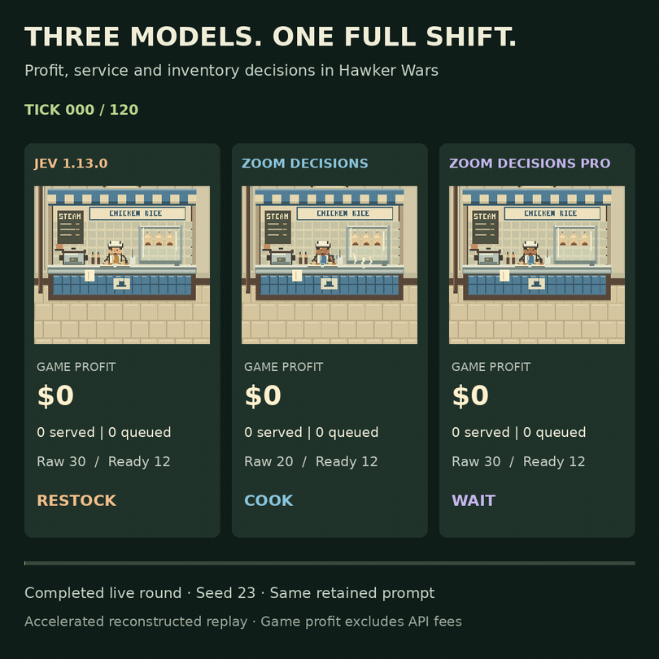

# Hawker Wars

Hawker Wars is a chicken-rice-stall simulation for studying **sequential decisions**. A policy runs an independent stall for a 120-tick lunch shift, choosing when to restock, cook, serve, promote, or wait. Deliveries and cooking take time; customers can leave; prepared food can expire. Each choice changes the state of the next decision.



*Recorded seed-23 replay, accelerated through simulated ticks. It does not show model response latency.*

[Read the evaluation article](https://jenzushsu.github.io/hawker-wars/) for the prompts, run configurations, results, action timelines, stockout charts, and limits of the comparison.

## Explore locally

Use Node **24.19.0** and pnpm **11.25.0**. From the repository root:

```sh
pnpm install --frozen-lockfile
pnpm demo:rules 0 clean
pnpm dev:web
```

The rules demo runs entirely offline. The web app opens at `http://localhost:3000` and includes recorded replay and analysis views. These steps do not make paid model calls or require provider credentials.

To run the code checks:

```sh
pnpm check
pnpm typecheck:web
```

`pnpm check` includes the full simulation validation suite and may take several minutes. Live model rounds use separate backend services and spending controls; the offline commands above do not start them.

## What is being compared?

All controllers share the same simulation mechanics and legal-action checks. The fixed **Rules** controller is a hand-authored heuristic, not an optimal solver or an answer key. Model runs can also use a Rules fallback after an invalid or timed-out response; the recorded action source identifies those cases. A compulsory WAIT, when no other action is legal, is different from a model choosing WAIT.

The simulator reports final utility, game profit, customers served, waste, and abandonment. Game dollars are separate from provider API charges. The [article](https://jenzushsu.github.io/hawker-wars/) keeps historical experiments apart from newer repeated runs and explains their limitations.

## Repository guide

| Path | What it contains |
|---|---|
| [apps/web](apps/web) | Web interface, replay, and live viewing |
| [packages/simulation](packages/simulation) | State transitions, demand, legality, and scoring |
| [packages/decisions](packages/decisions) | Fixed Rules policy and action attribution |
| [packages/providers](packages/providers) | Model adapters and bounded dispatch |
| [packages/replay](packages/replay) | Recorded-run replay and export support |
| [site](site) | Git-backed article, figures, GIF, and source data |
| [docs](docs) | Design, validation, and deployment records |

The [simulation scoring code](packages/simulation/src/scoring.ts) defines the outcome measures. [Offline validation](docs/p2-a-validation.md) and [replay validation](docs/p2-b-validation.md) document how recorded runs are checked.

## Credentials and data

Offline development needs no credentials. Keep live-service credentials outside Git and out of browser code. Local environment files are ignored; [`.env.example`](.env.example) contains only blank fields. Do not put credential values in source files, examples, screenshots, or issue reports.
