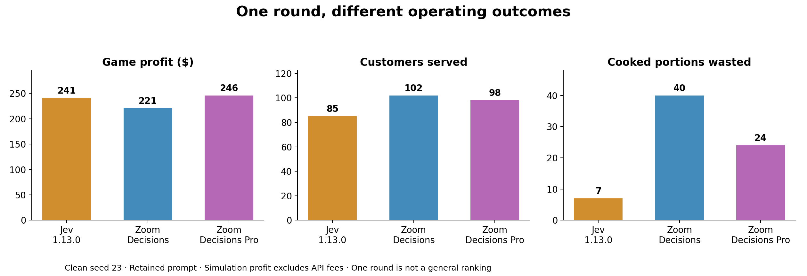
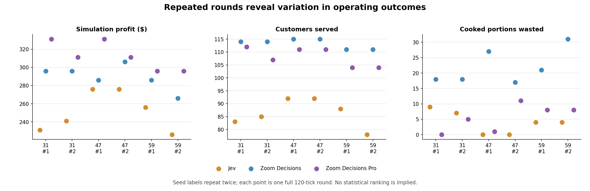
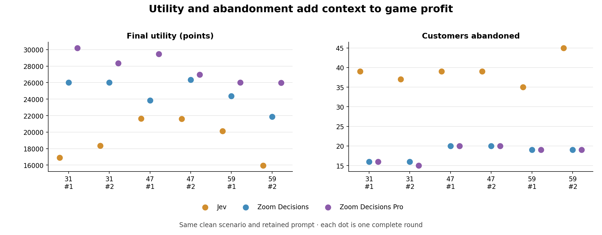
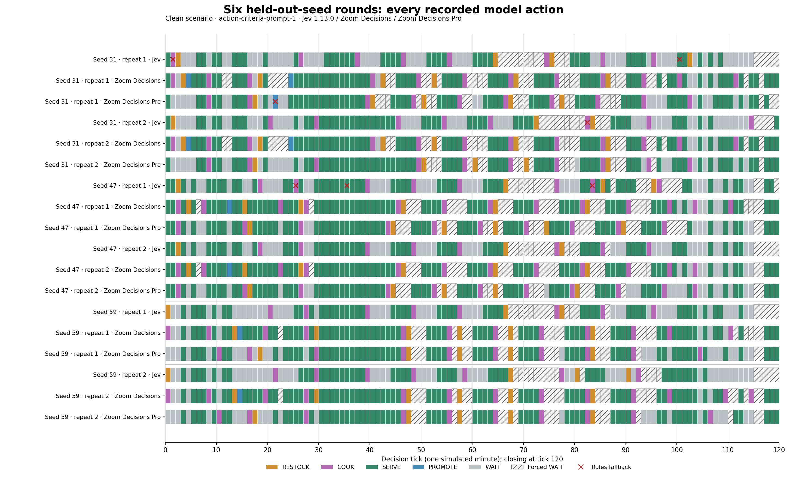
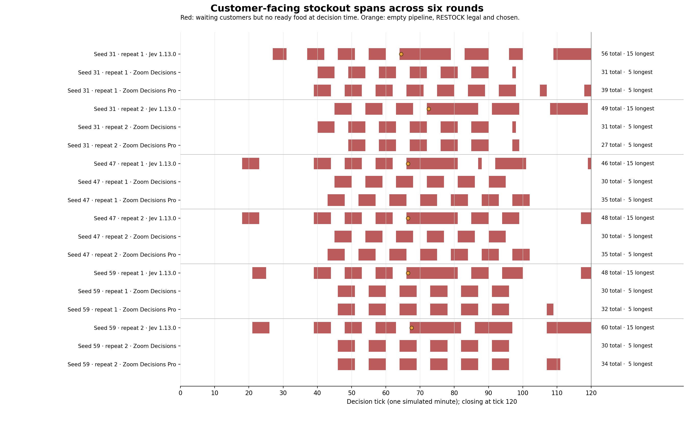
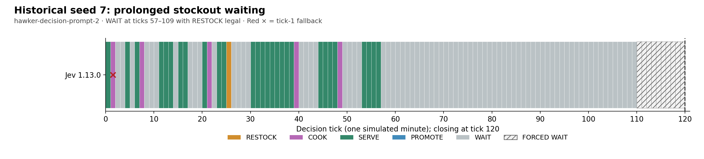
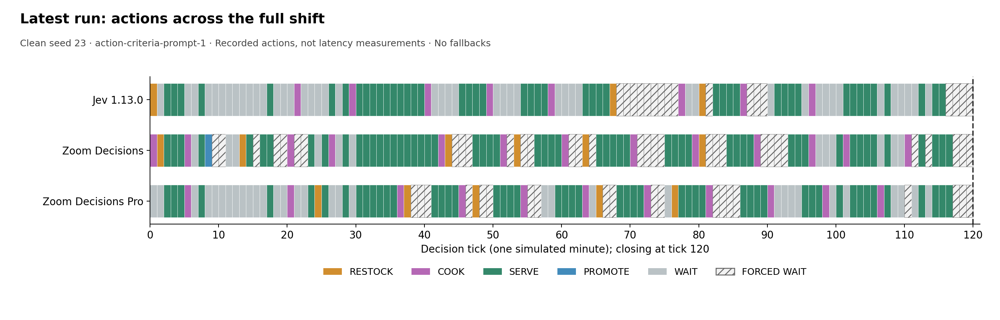

# From Mario to Hawker Wars: Decision Models in Sequential Operations

**How do fast decision models perform in sequential operations, and how does planning support affect their choices?** A model can choose a valid action and still leave customers hungry. Hawker Wars makes that distinction visible by asking models to operate simulated chicken rice stalls for a full lunch shift.

In six full rounds with the same retained prompt across three new demand seeds, Zoom Decisions Pro led the three models on game profit and final utility each time, while Zoom Decisions served the most customers. Jev 1.13.0 no longer repeated a historical pattern of waiting through an empty supply pipeline, yet it served fewer customers and had longer periods with waiting customers but no ready food. These are outcomes of specific model, prompt, interface and simulator configurations—not a general verdict about a model's planning ability.

## From measured Mario moves to hawker-stall decisions

In [*Seven Moves, One Flag*][mario-article], the Mario emulator simulated seven candidate moves and their follow-ups, restored the starting state, and gave each model the measured outcomes. The model selected one move to execute; hypothetical follow-ups required later decisions. In the final default-depth batches on stage 1-1, Jev 1.13.0, Zoom Decisions and Zoom Decisions Pro each cleared their respective ten episodes. Mario requested `jev-latest` and verified returned `jev-1.13.0`, plus Zoom API IDs `zoom-decisions` and `zoom-decisions-pro`; Hawker Wars configured `jev-1.13.0`, `zoom-decisions-standard` and `zoom-decisions-pro`. These service IDs are not immutable weight snapshots. Mario's result concerns action selection **with simulator-generated candidate evidence** on one stage, not unaided play or unseen levels. [Mario source Markdown][mario-source]

Hawker Wars' original interface supplied the current stall state, public mechanics and currently legal actions. It did not simulate each candidate action and hand the model measured future outcomes before asking for a choice. Later Hawker prompts added shared planning guidance and state-derived supply summaries; separate diagnostics let models select between supplied conditional plans. Selecting a supplied plan is different from constructing and carrying out one unaided.

| Experiment | Planning support supplied before the choice | What the model selected |
|---|---|---|
| Mario stage 1-1 | Simulator-measured outcomes for seven candidate moves and follow-ups | One move to execute |
| Hawker Wars original interface | Current observation, mechanics, legal actions and final-utility objective | One stall action |
| Hawker Wars later diagnostics | Explicit future-turn guidance, state-derived timing summaries, or supplied conditional plans in separately labeled tests | The next action or one supplied plan |

The comparison is therefore about the **whole decision setup**: what evidence and planning support the application provides, what the model selects, and what happens after many selections. Neither experiment by itself isolates a general planning trait of a model.

## The use case: a small action space with delayed consequences

Each model operates an independent stall. At every decision tick, it receives its current observation, public game mechanics, recent action history and legal choices. It selects one action: **RESTOCK, COOK, SERVE, PROMOTE or WAIT**.

An order normally takes ten simulated minutes to arrive. Cooking takes five. Customers lose patience, prepared food expires, and service closes at tick 120. Time and background work progress during every action; WAIT is not required for a delivery or cooking job to finish. When WAIT is the sole legal action, the worker applies it locally without making a model call.

Profit and utility are different measures. Closing profit includes remaining cash and raw-ingredient salvage, less starting wealth. Utility also penalizes unserved customers, accumulated waiting and cooked-food waste. The models are instructed to maximize final utility, so profit alone is an incomplete evaluation. All monetary results below are **simulation dollars, excluding API fees**. [Simulation scoring][scoring]

The simulator's mechanics determine deliveries, cooking, patience, spoilage and scores for **every** controller. Legal-action checks determine which choices are possible at a particular state; they do not choose a strategy. The fixed **Rules** controller is a separate, hand-authored heuristic that chooses actions from those legal options. It provides a useful practical reference, but it is neither an optimal solver nor a set of ground-truth labels, and it has no guarantee of winning other scenarios. A **rules fallback** is yet another role: after an invalid or timed-out model response, the worker records that failure and uses the fixed controller's action for that tick. These model-plus-fallback trajectories must be labeled as such.

## The starting point: one published seed-23 round

The original headline comparison is completed published round `a4366c8c-a68e-4699-adcc-f06e754ef352`, using the **clean scenario, demand seed 23, and 120 decision ticks followed by closing**. The six later rounds are presented separately below.

| Item | Verified configuration |
|---|---|
| Shared model prompt | `action-criteria-prompt-1` |
| Jev | `jev-1.13.0` |
| Zoom Decisions | API model ID `zoom-decisions-standard` |
| Zoom Decisions Pro | API model ID `zoom-decisions-pro` |
| Worker revision | `e86ca1e` |
| Execution | No voting or safeguard overriding model choices; no provider fallbacks occurred |

The Zoom entries identify the configured API models; the evidence does not establish an immutable, dated backend weight version. Jev's returned identity was checked against the pinned version. We should not claim more version precision than the records support. [Runtime manifest][runtime] · [Verified run report][latest]

All models used the same request-building rules and instructions, but each received its own evolving observation. A shared seed does not mean identical realized customer totals: promotions can add arrivals. The experiment shares mechanics and starting conditions without forcing the models into identical trajectories.

A frozen Rules controller also ran as a hand-authored reference. Its result appears in the table for context, not as an optimal score or a per-tick answer key.

## The published seed-23 result: three different trade-offs

| Model | Game profit | Served | Unserved / abandoned | Cooked portions wasted | Utility |
|---|---:|---:|---:|---:|---:|
| Jev 1.13.0 | $241 | 85 | 34 | 7 | 18,625 |
| Zoom Decisions | $221 | 102 | 19 | 40 | 16,935 |
| Zoom Decisions Pro | $246 | 98 | 21 | 24 | 19,475 |
| Rules heuristic | $311 | 120 | 2 | 22 | 29,165 |



Zoom Decisions Pro finished $5 ahead of Jev. Zoom Decisions served 17 more customers than Jev, but also wasted 33 more cooked portions and earned $20 less. Jev's lower waste accompanied lower service volume; it does not establish that the model deliberately optimized for waste reduction.

These are descriptive outcomes from one round. Neither the small profit gap nor the different trade-offs establish a reliable winner across conditions. [Closing results and replay analysis][latest]


The replay is a reconstruction of simulated ticks, not footage of API response time.

## Six more full shifts with the retained prompt

To test whether that finish order survived a change in demand, we froze the **clean scenario**, `action-criteria-prompt-1`, Jev **1.13.0**, and the same configured Zoom Decisions and Zoom Decisions Pro API model IDs. Seeds **31, 47 and 59** had not been used in the earlier campaigns; each ran **twice** for 120 decisions plus closing. All three decision models and the frozen Rules reference started with the same mechanics and seed in a round, then controlled separate evolving stalls. The repeats were completed but not published as live viewer rounds. [Repeated-seed evidence][repeats]

The following table keeps **all five outcomes** and each run’s fallback count visible. The two repeats of a seed share its potential demand schedule; promotions and other choices can still change each stall’s arrivals and later states. Utility is the instructed objective; profit is simulated game profit, excluding API charges.

| Seed / repeat | Model | Utility | Profit | Served | Wasted | Abandoned | Fallbacks |
|---|---|---:|---:|---:|---:|---:|---:|
| 31 / 1 | Jev 1.13.0 | 16,905 | $231 | 83 | 9 | 39 | 2 |
| 31 / 1 | Zoom Decisions | 26,020 | $296 | 114 | 18 | 16 | 0 |
| 31 / 1 | Zoom Decisions Pro | 30,200 | $331 | 112 | 0 | 16 | 1 |
| 31 / 2 | Jev 1.13.0 | 18,365 | $241 | 85 | 7 | 37 | 1 |
| 31 / 2 | Zoom Decisions | 26,020 | $296 | 114 | 18 | 16 | 0 |
| 31 / 2 | Zoom Decisions Pro | 28,345 | $311 | 107 | 5 | 15 | 0 |
| 47 / 1 | Jev 1.13.0 | 21,640 | $276 | 92 | 0 | 39 | 3 |
| 47 / 1 | Zoom Decisions | 23,850 | $286 | 115 | 27 | 20 | 0 |
| 47 / 1 | Zoom Decisions Pro | 29,455 | $331 | 111 | 1 | 20 | 0 |
| 47 / 2 | Jev 1.13.0 | 21,620 | $276 | 92 | 0 | 39 | 0 |
| 47 / 2 | Zoom Decisions | 26,350 | $306 | 115 | 17 | 20 | 0 |
| 47 / 2 | Zoom Decisions Pro | 26,955 | $311 | 111 | 11 | 20 | 0 |
| 59 / 1 | Jev 1.13.0 | 20,140 | $256 | 88 | 4 | 35 | 0 |
| 59 / 1 | Zoom Decisions | 24,365 | $286 | 111 | 21 | 19 | 0 |
| 59 / 1 | Zoom Decisions Pro | 26,000 | $296 | 104 | 8 | 19 | 0 |
| 59 / 2 | Jev 1.13.0 | 15,940 | $226 | 78 | 4 | 45 | 0 |
| 59 / 2 | Zoom Decisions | 21,865 | $266 | 111 | 31 | 19 | 0 |
| 59 / 2 | Zoom Decisions Pro | 25,980 | $296 | 104 | 8 | 19 | 0 |





A **voluntary WAIT** is a model-selected WAIT when another action was legal. A **compulsory WAIT** is the sole legal action and is applied locally, without a model request. These are different from a Rules fallback; none of the seven fallbacks below selected WAIT. Counts are voluntary / compulsory:

| Seed / repeat | Jev 1.13.0 | Zoom Decisions | Zoom Decisions Pro |
|---|---:|---:|---:|
| 31 / 1 | 50 / 17 | 7 / 30 | 22 / 21 |
| 31 / 2 | 44 / 16 | 7 / 30 | 23 / 17 |
| 47 / 1 | 36 / 20 | 6 / 27 | 15 / 25 |
| 47 / 2 | 40 / 18 | 9 / 25 | 22 / 18 |
| 59 / 1 | 44 / 18 | 7 / 26 | 25 / 18 |
| 59 / 2 | 47 / 19 | 6 / 26 | 24 / 19 |

Across these six rounds, Zoom Decisions Pro led the decision models in game profit **and final utility** every time; its mean profit was **$312.67** (range $296–$331) and mean utility **27,822.5**. Zoom Decisions served the most customers every time, averaging **113.3**; Zoom Decisions Pro averaged **108.2**, and Jev **86.3**. Jev's mean waste was **4.0** portions, but it served far fewer customers and abandoned **35–45** per round, versus **16–20** for Zoom Decisions and **15–20** for Zoom Decisions Pro. Jev wasted the least in four rounds, while Zoom Decisions Pro did so in the other two. The seed-23 profit order—Zoom Decisions Pro, Jev, Zoom Decisions—did **not** persist in these three other demand schedules. Even within seed 59, Jev's profit changed from $256 to $226 across repetitions while Zoom Decisions Pro's stayed at $296.

The separate Rules heuristic earned **$331–$356** profit, **31,655–33,430** utility and served **124–129** customers across these six rounds. Those observed results show what its explicit strategy achieved here. They do not establish an optimal ceiling or a guarantee against a model on another state or scenario. [Rules and repeat results][repeats]

There were **seven Rules fallbacks** among the 18 model trajectories: six invalid Jev responses and one Zoom Decisions Pro timeout. They occurred in the seed-31 runs and seed-47's first repetition; seed-47's second repetition and both seed-59 rounds were fallback-free. A score with a fallback is a mixed model-and-Rules outcome, not a pure model-only outcome. Differences also appeared between fallback-free repetitions, so the fallback count does not by itself explain all variation. Independent replay reproduced every closing score and found **zero empty-pipeline WAITs with RESTOCK legal** for all three models across these repeats. That is evidence that the retained prompt avoided the specific earlier Jev failure here, not that it made Jev the strongest operator.



The action timeline shows each recorded decision, including forced WAITs applied locally when WAIT was the only legal action. A SERVE action can handle several customers; these colored cells are action counts, not customer counts. Three distinct seeds with two repeats each are still too few to claim a stable population ranking. Further seeds, disturbances, and repeated provider calls would better measure how often each model leads and how robust its API responses are. [Recorded repeated actions][repeat-actions]

The per-tick replay also measures a **customer-facing stockout**: an observation with customers waiting but no ready food. This includes periods when ingredients are already on order or cooking; it does **not** mean the model chose to WAIT or left the entire supply pipeline empty. Jev had 46–60 such ticks per round, including one uninterrupted **15-tick** interval in every repeat. Zoom Decisions had 30–31 such ticks and Zoom Decisions Pro 27–39; their longest intervals were **five ticks** in these runs. [Stockout intervals][stockout-data]



Jev encountered one tick per repeat with an entirely empty pipeline and RESTOCK legal, then **selected RESTOCK immediately** at that tick. The subsequent customer-facing gap reflects the delivery and cooking delay, not the prolonged empty-pipeline WAIT pattern from the earlier seed-7 prompt. It is still an operationally important gap: customers can abandon while food is unavailable. Every chart here uses **simulated one-minute ticks** on its horizontal axis. Provider inference latency is wall-clock time and is not plotted as simulated delay.

## The evaluation journey: keep the experiments distinct

### Historical seed 7: clearer mechanics did not resolve replenishment

The early comparisons used **clean seed 7** with the original prompt (v1) and `hawker-decision-prompt-2`. These are separate from the later `action-criteria` prompt family; the two “v2” labels must not be confused.

| Seed-7 prompt | Controller | Utility | Profit | Served | Wasted | Abandoned | Fallbacks |
|---|---|---:|---:|---:|---:|---:|---:|
| Original v1 | Jev 1.13.0 | 700 | $106 | 46 | 16 | 66 | 1 |
| Original v1 | Zoom Decisions | 18,390 | $226 | 98 | 34 | 14 | 0 |
| Original v1 | Zoom Decisions Pro | 22,955 | $261 | 101 | 21 | 11 | 0 |
| Original v1 | Rules heuristic | 29,790 | $311 | 116 | 16 | 2 | 0 |
| `hawker-decision-prompt-2` | Jev 1.13.0 | 870 | $106 | 46 | 16 | 66 | 1 |
| `hawker-decision-prompt-2` | Zoom Decisions | 20,765 | $251 | 109 | 33 | 14 | 0 |
| `hawker-decision-prompt-2` | Zoom Decisions Pro | 25,260 | $281 | 101 | 11 | 11 | 0 |
| `hawker-decision-prompt-2` | Rules heuristic | 29,790 | $311 | 116 | 16 | 2 | 0 |

The second prompt made action consequences, delivery and cooking delays, customer patience and closing value more explicit. Zoom Decisions served more customers, while Zoom Decisions Pro retained more value by wasting fewer cooked portions. One run per condition cannot isolate the prompt's effect from model variation and the resulting different trajectories.

Jev's replenishment failure persisted. In the seed-7 prompt-2 run, it chose WAIT at ticks **57–109**, despite an empty supply pipeline and RESTOCK being legal. These 53 accepted model choices were not timeouts or exhausted budgets. The run did contain a separate invalid-probability fallback at tick 1; it must therefore remain labeled as a run with a fallback, even though that incident does not explain the later accepted WAIT sequence. [Historical comparison][seed7]



At tick 57, replenishment followed by cooking could support later arrivals, even if it could not rescue the current queue. Near closing, the same logic changes: an order at 109 arrives at 119 and cannot finish a five-minute cook before 120. Legal restocking is not automatically beneficial restocking.

Captured-state tests then explored richer planning instructions and supplied conditional plans. In the initial plan-selection diagnostic, all three models chose immediate replenishment at tick 57. That was evidence of sensitivity to framing, not evidence that they could construct and execute the same plan independently. Those diagnostic selections were not themselves full simulation outcomes. [Planning tests][planning] · [Initial short-plan diagnostic][plans]

### Shared planning, request size and model version were separate questions

A subsequent shared-planning campaign used seeds 7, 11 and 23. Jev still placed only one restock per round. There was no coded one-restock limit: repeated orders remained legal. The seed-23 run also exposed two request-size fallbacks for the Zoom models, so it cannot be presented as entirely model-driven execution.

Prompt `hawker-decision-prompt-4` compacted the shared observation representation while retaining its information. A new seed-23 round completed without fallbacks, but raw Jev 1.13.0 still earned $96, served 44 customers and made 47 empty-pipeline WAIT choices with RESTOCK legal. Solving the request-envelope issue did not solve the replenishment behavior. [Shared-planning campaign and format fix][fair] · [Full prompt-4 round][v4]

A separate raw Jev 1.14.0 test under prompt 4 earned $71 and served 39, with 51 such waits. That single run did not demonstrate a general version regression, but it did not resolve this observed failure either. A safeguard-assisted hybrid earned $191 in another experiment; that belongs to a different policy and must not be presented as unmodified Jev performance. [Version comparison][jev114]

### Concise action criteria changed the observed trajectory

The next candidate, **`action-criteria-prompt-1`**, retained the shared mechanics and legal options but reorganized the instructions around concrete action criteria. It asked the model to evaluate ready food, cooking, raw stock and incoming deliveries together, consider customers arriving after replenishment, and recognize that WAIT cannot refill an empty pipeline.

It also derived a short pipeline summary and an optimistic earliest-food time from public state. Those calculations did not expose hidden arrivals or choose an action for the model. Follow-up actions still had to be selected on later ticks. [Prompt implementation][criteria-code]

In a Jev-only seed-23 run, this candidate produced **$241 profit, 85 served and 7 wasted**, with three restocks and zero empty-pipeline WAITs while RESTOCK was legal. The model resumed its own supply chain without a code-level override. Compared with the earlier raw prompt-4 run, that was a substantial observed improvement, but several instructions and the derived summary changed together. It is not a causal estimate for any single sentence. [First action-criteria full round][criteria]

### A local improvement failed the full-round test

The first action-criteria run still contained a useful diagnostic: at ticks 86–87, Jev had usable raw ingredients and waiting customers but delayed cooking while another delivery approached.

`action-criteria-prompt-2` clarified that deliveries progress during other actions and explicitly compared cooking existing stock now with waiting for incoming stock. Across the two saved states, it selected COOK in six of six treatment calls, versus one of six baseline calls. These were small, targeted tests with three repetitions per state and condition—not a general reliability estimate. [Cooking clarification test][cooking]

The full seed-23 run told a different story. Jev 1.13.0 under action-criteria prompt 2 earned **$71, served 39 and wasted 23**, with **61 empty-pipeline WAITs** while RESTOCK was legal. It eliminated cooking-legal waits on that trajectory but reintroduced a larger replenishment failure.

The candidate was rejected, and **action-criteria prompt 1 was retained**. This is the central evaluation lesson: fixing the response to a saved state can change earlier choices, causing the model to encounter a completely different set of states later. [Full-round regression][criteria-v2] · [Prompt selection][selection]

The latest published all-model round then repeated Jev's **$241 / 85 served / 7 wasted** outcome under the retained prompt. Its action sequence and utility were not identical to the earlier run. Repeating headline totals on the same seed supports further testing; it does not establish cross-seed reliability.

## The prompts actually used

The historical rounds, the published seed-23 round and the six repeats did not use one interchangeable "v2" prompt. They used the following versions, with the same public simulator rules and legal-action schema within each comparison:

| Experiment | Shared prompt sent for decisions | Relevant change |
|---|---|---|
| Historical clean seed 7, first comparison | Original prompt v1 | Initial decision framing; retained as historical evidence. |
| Historical clean seed 7, second comparison | `hawker-decision-prompt-2` | Explicit action consequences, waiting, delays and closing value. |
| Three-seed planning campaign | `hawker-decision-prompt-3` | Shared planning guidance over future turns and repeated restocking. |
| Raw Jev version tests and seed-23 v4 round | `hawker-decision-prompt-4` | Same planning semantics with compact observation tables and public action rules. |
| Jev-only test, published seed-23 comparison and six repeated rounds | `action-criteria-prompt-1`, built on the prompt-4 context | Short action criteria and state-dependent pipeline/restock summary. **This is the retained prompt.** |
| Jev-only cooking test and regression round | `action-criteria-prompt-2`, built on the prompt-4 context | Added cooking-versus-delivery timing and queued-customer deadline calculations. Rejected after the full round. |

Here is the **verbatim fixed instruction block** from the retained `action-criteria-prompt-1` builder. It was used for Jev 1.13.0, Zoom Decisions and Zoom Decisions Pro in the published seed-23 comparison and all six repeats; the provider wire formats place it in different fields:

```text
Choose one legal action to maximize final utility at tick 120 using the supplied rules. Return the typed choice; do not infer hidden arrivals.
Evaluate ready food, cooking, raw stock and pending delivery together.
SERVE: Prioritize waiting customers when food is ready; delay risks abandonment or spoilage.
COOK: Consider cooking when ready supply is insufficient for expected demand; account for completion time and spoilage.
RESTOCK: Consider replenishment before supply runs out. An empty pipeline needs an order. Consider arrivals after delivery/cooking, not only the current queue. Repeat orders are allowed.
WAIT: Use when work progresses, delay avoids waste, or other actions offer no expected utility gain. WAIT cannot replenish stock.
PROMOTE: Consider extra demand when supply and service capacity can support it.
Account for closing salvage and penalties. Follow-up actions are not automatic. Tables use named columns; queue rows are FIFO.
```

Each request appended the current pipeline state—raw and ready portions, cooking and delivery due ticks—and an optimistic earliest-food calculation if RESTOCK was legal. It also stated when restocking could no longer lead to cooked food before closing. The observation, legal actions, public rules and final-utility objective were supplied as structured context; this block alone was not the complete request. Those dynamic fields change at every tick, so a single static quotation cannot represent all requests. The exact builders preserve their wording and serialization: [retained action criteria][criteria-code], [rejected cooking clarification][criteria-v2-code], and [shared context/base prompts][wire-code].

For the earlier runs, the **original v1** question instruction was:

```text
Choose exactly one allowed action to maximize expected final utility at closing. Use the supplied observation and public game rules. Return the typed choice only; do not infer hidden schedules or seeds.
```

The **historical prompt 2** used that opening, then added `Allowed actions and consequences:` followed by the lines for actions legal on that tick, selected from this exact list:

```text
SERVE: Serve min(3, queue length, ready portions), FIFO; consume earliest-expiring ready portions; earn 500 cents each. No passive service.
COOK: One idle cooker takes 10 raw portions, reserves ready capacity and completes after 5 minutes; newly ready portions expire 20 minutes after completion.
RESTOCK: Pay 4000 cents for 20 raw portions; one pending order; delivery after 10 minutes or 15 during supplier delay; must arrive before closing.
PROMOTE: Pay 500 cents for extra arrival opportunities over next 10 ticks, with next activation at t+20; otherwise unchanged mechanics.
WAIT: Consume this turn without direct action; background arrivals, patience, spoilage and timers continue.
```

It ended with this exact line:

```text
Consider delivery and cooking delays, remaining time, customer patience and closing inventory value. WAIT does not place an order, start cooking or serve customers.
```

**Prompt 3** kept prompt 2 and appended this fixed planning text:

```text
Plan across future turns: replenishing raw stock enables later cooking and serving. Consider future customer arrivals as well as the current queue, using only the public demand rates.
Choose only the next action now. You will receive an updated observation and reassess on every following decision turn unless WAIT is the only legal action. A plan does not automatically execute later actions.
There is no one-order limit. RESTOCK may be chosen repeatedly across the round whenever legal, after earlier orders complete. Reconsider the stock pipeline throughout all 120 decision ticks.
Compare the next 20 minutes and closing value. Account for delivery and cooking delays, spoilage, customer patience and retained raw inventory. WAIT can be appropriate while work is in progress or when further action has no expected benefit. Do not force restocking or cooking near closing.
```

**Prompt 4** kept those opening and planning instructions. It replaced the per-tick action list with the following line, since the same action definitions already appeared in the structured `publicRules.actions` context:

```text
Action consequences are defined in publicRules.actions; consider them for current and future turns. Tables use named columns and ordered rows; queue rows remain FIFO.
```

The **rejected action-criteria prompt 2** started from the retained action-criteria block above, changed only its WAIT line to the following, then appended a cooking-versus-delivery reminder and tick-specific calculations:

```text
WAIT: Compare waiting with useful actions available now; background work progresses during any action. Wait when delay avoids waste or alternatives offer no expected utility gain. WAIT cannot replenish stock.
A pending delivery does not prevent cooking raw stock already on hand. Do not wait solely because a delivery is approaching.
```

For every version, the legal-action list, observations, public rules and final-utility formula were part of the actual request, not just the quoted instruction text. The [historical v1 request][v1-wire] and the versioned builders above make those state-dependent parts inspectable. The six repeated rounds described above reused **action-criteria prompt 1** exactly; no prompt was tuned between their seeds or repetitions.

## What the per-tick logs show

The following detailed chart comes from the published seed-23 round's recorded decisions. Each colored cell marks the action taken at one simulated-minute tick; it does not represent API latency or the duration of the delivery/cooking job that action starts. Hatched cells distinguish forced WAITs from model-selected WAITs. The six-round timeline above uses the same convention and additionally marks fallbacks.



| Model | RESTOCK ticks | COOK actions | SERVE actions | Voluntary WAITs | Forced WAITs | Last SERVE tick |
|---|---|---:|---:|---:|---:|---:|
| Jev 1.13.0 | 0, 67, 80 | 8 | 46 | 46 | 17 | 115 |
| Zoom Decisions | 1, 13, 43, 53, 63, 80 | 13 | 56 | 12 | 32 | 116 |
| Zoom Decisions Pro | 24, 37, 47, 65, 76 | 11 | 51 | 33 | 20 | 116 |

Zoom Decisions also selected PROMOTE once; the other two models did not. A SERVE action can serve multiple customers, so action counts must not be confused with customer totals.

Jev ordered at tick 67, cooked when that delivery arrived at 77, and ordered again at 80. It cooked at **21, 29, 40, 49, 58, 77, 86 and 96**, then continued serving until 115. The historical seed-7 stockout-wait sequence does not describe this latest trajectory. Nor should the earlier tick-86/87 hesitation be copied into this run: the latest Jev selected COOK at 86, under a different state history.

All three models had **zero WAITs with SERVE legal** and **zero empty-pipeline WAITs with RESTOCK legal**. Jev nevertheless had 23 WAITs with COOK legal. Legality alone does not identify an error: queue size, ready stock, cooking time, spoilage and time remaining all affect whether cooking is worthwhile. [Recorded actions][decisions] · [Replay analysis][analysis]

## How this differs from Contested Fast Decisions

[Contested Fast Decisions](https://huggingface.co/datasets/zoom-ai/contested-fast-decisions) contains 818 decisions over 696 texts across 17 domains. It retains disagreements among eight filter models, then uses independent model relabeling and adjudication. Its API evaluation supplies task names and candidate labels without label descriptions; single-label tasks use a choice, while multi-label tasks use per-label yes/no questions. Accuracy requires an exact match to the reference label set.

| Dimension | Contested Fast Decisions | Hawker Wars |
|---|---|---|
| Input | Fixed text and classification task | Current simulated operating state |
| Feedback | Label scored against a reference | Action changes the next state |
| Main outcome | Exact-match accuracy | Closing utility, profit, service, waste and abandonment |
| Evaluation unit | Individual decision | Full sequence of decisions |

The published leaderboard reports **73.7% for Zoom Decisions Pro, 69.3% for Zoom Decisions, 62.6% for Jev 1.13.0 and 66.0% for Jev 1.14.0**. These are publisher-reported classification results, not measurements from Hawker Wars. [Dataset methodology and leaderboard](https://huggingface.co/datasets/zoom-ai/contested-fast-decisions)

The published seed-23 simulation profit order differed from the six held-out repeats. Neither should be used to infer a matching ranking or correlation with classification accuracy: these evaluations use different inputs, prompts, feedback and outcome measures. Hawker Wars has no proven optimal reference action for every tick, so its logged choices should not be assigned an “accuracy” by comparing them with the hand-authored Rules controller.

The evaluations are complementary. Classification tests whether a model can resolve a supplied decision. The simulation tests whether repeated choices sustain useful outcomes as earlier decisions constrain later options.

## What we can conclude—and what to test next

The strongest result is about the model-and-support configuration. Valid outputs, successful API calls, sensible isolated choices and good full-round outcomes are distinct achievements. Mario's final stage clears came from selecting among simulator-measured moves and follow-ups. Hawker Wars' original interface supplied current state and mechanics without that candidate simulation. Its later prompts and conditional-plan diagnostics changed the support available, and the cooking-prompt regression showed that a better choice on saved states can lead to worse complete-round results.

The published seed-23 round completed with **291 successful paid calls: 103 for Jev, 88 for Zoom Decisions and 100 for Zoom Decisions Pro**, without provider errors, retries or fallbacks. Offline replay verified all 480 decisions across the three models and Rules, with 121 unique tick commits including closing. The six repeats added **612 Jev and 1,158 Zoom-model dispatches** and replayed all **2,880** recorded decisions; seven of those dispatches led to Rules fallbacks. This establishes execution integrity and exposes API reliability, not optimality. API budget reservations are not invoice costs and should not be subtracted from game dollars to claim real-world ROI. [Seed-23 verification and accounting][latest] · [Repeated-seed evidence][repeats]

A stronger next evaluation would add many more held-out seeds and repeat provider calls on the same states, still freezing prompts and model identities. Matched-state tests could compare choices on identical observations, while full rounds would measure their downstream consequences. Demand shocks and delivery delays would test adaptation. Actual API charges, latency and failure rates would establish deployment cost separately from simulated operating results.

In the six comparable new-seed repetitions, **Zoom Decisions Pro led model profit and utility, while Zoom Decisions served the most customers.** Jev generally wasted little food but served fewer people, abandoned more, and had longer customer-facing stockouts; its historical empty-pipeline WAIT sequence did **not** recur. The separately published seed-23 round provides a counterexample to a fixed Jev-versus-Zoom profit order. Some repeated trajectories include Rules fallbacks, and only three new demand schedules were tested. These observations do not identify a model's general planning ability. The next useful comparison would vary planning support under controlled, repeated conditions and measure the resulting full trajectories—not infer ability from a single action or a static benchmark rank.

<p class="signoff">— Jenzus Hsu · In collaboration with GPT Astra</p>

[scoring]: https://github.com/jenzushsu/hawker-wars/blob/34ddc5c71699d5ab757eabeefab080a0dc8071ce/packages/simulation/src/scoring.ts
[runtime]: https://github.com/jenzushsu/hawker-wars/blob/34ddc5c71699d5ab757eabeefab080a0dc8071ce/manifests/provider-runtime-live-retained.json
[latest]: https://github.com/jenzushsu/hawker-wars/blob/34ddc5c71699d5ab757eabeefab080a0dc8071ce/docs/deployment/live-retained-results.md
[seed7]: https://github.com/jenzushsu/hawker-wars/blob/34ddc5c71699d5ab757eabeefab080a0dc8071ce/docs/deployment/prompt-v2-comparison.md
[planning]: https://github.com/jenzushsu/hawker-wars/blob/34ddc5c71699d5ab757eabeefab080a0dc8071ce/docs/deployment/planning-experiment.md
[plans]: https://github.com/jenzushsu/hawker-wars/blob/34ddc5c71699d5ab757eabeefab080a0dc8071ce/docs/deployment/short-plan-experiment.md
[fair]: https://github.com/jenzushsu/hawker-wars/blob/34ddc5c71699d5ab757eabeefab080a0dc8071ce/docs/deployment/fair-120-tick-campaign.md
[v4]: https://github.com/jenzushsu/hawker-wars/blob/34ddc5c71699d5ab757eabeefab080a0dc8071ce/docs/deployment/v4-full-campaign.md
[jev114]: https://github.com/jenzushsu/hawker-wars/blob/34ddc5c71699d5ab757eabeefab080a0dc8071ce/docs/deployment/jev114-comparison.md
[criteria-code]: https://github.com/jenzushsu/hawker-wars/blob/34ddc5c71699d5ab757eabeefab080a0dc8071ce/packages/providers/src/action-criteria-experiment.ts
[criteria]: https://github.com/jenzushsu/hawker-wars/blob/34ddc5c71699d5ab757eabeefab080a0dc8071ce/docs/deployment/criteria-comparison.md
[cooking]: https://github.com/jenzushsu/hawker-wars/blob/34ddc5c71699d5ab757eabeefab080a0dc8071ce/docs/deployment/cooking-test.md
[criteria-v2]: https://github.com/jenzushsu/hawker-wars/blob/34ddc5c71699d5ab757eabeefab080a0dc8071ce/docs/deployment/criteria-v2-full.md
[selection]: https://github.com/jenzushsu/hawker-wars/blob/34ddc5c71699d5ab757eabeefab080a0dc8071ce/docs/deployment/prompt-selection.md
[decisions]: https://github.com/jenzushsu/hawker-wars/blob/34ddc5c71699d5ab757eabeefab080a0dc8071ce/docs/deployment/evidence/live-retained/decisions.json
[analysis]: https://github.com/jenzushsu/hawker-wars/blob/34ddc5c71699d5ab757eabeefab080a0dc8071ce/docs/deployment/evidence/live-retained/analysis.json

[criteria-v2-code]: https://github.com/jenzushsu/hawker-wars/blob/34ddc5c71699d5ab757eabeefab080a0dc8071ce/packages/providers/src/action-criteria-v2-experiment.ts
[wire-code]: https://github.com/jenzushsu/hawker-wars/blob/34ddc5c71699d5ab757eabeefab080a0dc8071ce/packages/providers/src/wire.ts
[v1-wire]: https://github.com/jenzushsu/hawker-wars/blob/34ddc5c71699d5ab757eabeefab080a0dc8071ce/docs/providers/jev-smoke-plan.json
[repeats]: https://github.com/jenzushsu/hawker-wars/blob/22cbc8fd6f31ef767b4b1b348cbfe52d281ac580/docs/deployment/repeated-seed-evaluation.md
[repeat-actions]: https://github.com/jenzushsu/hawker-wars/blob/22cbc8fd6f31ef767b4b1b348cbfe52d281ac580/docs/deployment/evidence/repeated-seeds/timelines.json
[stockout-data]: stockout-summary.json
[mario-article]: https://medium.com/@jenzushsu/seven-moves-one-flag-putting-zoom-decisions-to-the-mario-test-829dc8d730ec
[mario-source]: sources/mario-article.md
